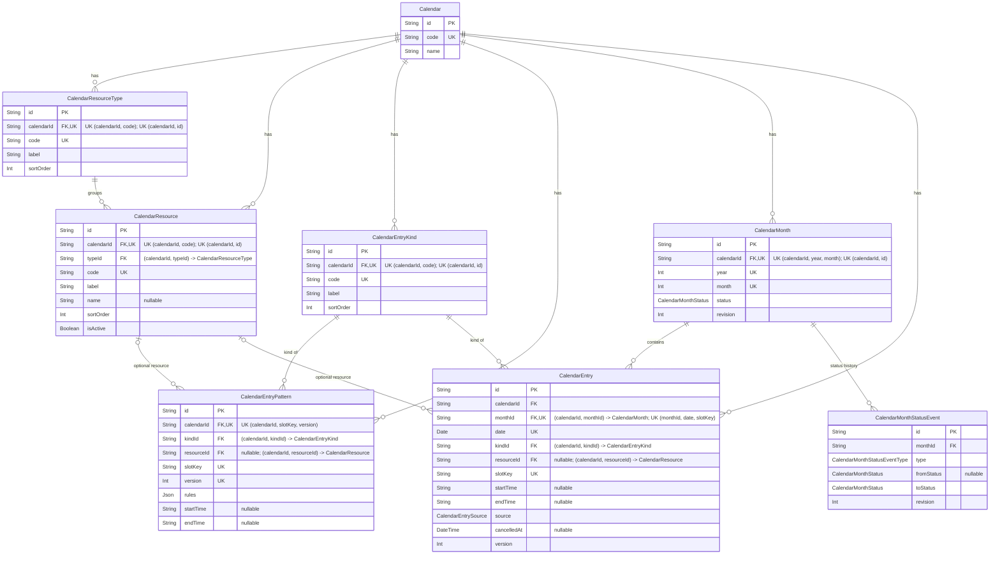

# Calendar Prisma

`~@modules/Calendar/prisma` holds the Calendar module's Prisma schema (`prisma/models/calendar.prisma`), its migrations and `getPrismaClient`. Each state that uses the Calendar has its own database (`CALENDAR__<STATE>`), so no table has a `stateCode` column. US_CO is the only state today.

`getPrismaClient(stateCode)` returns the client for that state's database, read from `CALENDAR__<STATE>_DATABASE_URL`. The state is required, so a caller always names the state the user is authorized for. It takes any state code and throws, naming the variable but never printing a URL, when that state's variable isn't set, so the states with a Calendar are the states whose variable is set.

## Data model

The tables and how they relate. Audit columns are left out. **Any change to `prisma/models/calendar.prisma` updates this diagram in the same PR.**



The `calendar_models` migration also adds CHECK constraints that Prisma can't express, such as `HH:mm` times and "a slotKey has a colon exactly when the entry has a resource". Foreign keys on `(calendarId, id)` stop a row from pointing at another calendar's type, kind, resource or month, because seed SQL inserts rows directly.

## Commands

```bash
nx local-dbs @modules/Calendar/prisma        # start the dev (port 6562) and test (port 6563) databases in Docker
nx prisma-generate @modules/Calendar/prisma  # generate the client into src/client
nx prisma-migrate @modules/Calendar/prisma --name <change>  # add a migration against the dev database
nx test @modules/Calendar/prisma
```
